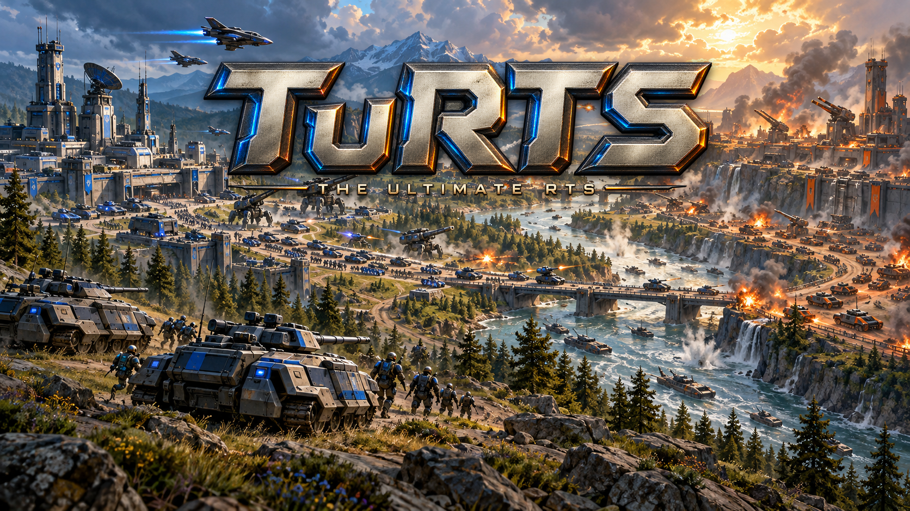

# TuRTS

[Concept art](docs/assets/turts-concept-art.png) · [Transparent title](docs/assets/turts-title.png)

[Social media kit](docs/assets/social/README.md) · [Download social images](docs/assets/social/turts-social-kit.zip)

A mod-first real-time strategy engine in Rust and Bevy. The browser WebAssembly client is the
primary target; an authoritative headless server runs the simulation. The official game is a
default mod that uses only the public mod API.

Status: M1 foundation in place. A Cargo workspace holds the headless server, the native and
browser clients, and the `base` package. The first measurements are in
`docs/measurements/m1.md`. Build and test commands are in `CLAUDE.md`.

- `RTS-Engine-Project-Specifications.md`: the design, with a decision register (D01 to D59).
- `CLAUDE.md`: how agents work in this repository.
- `.claude/agents/`: the sixteen studio subagents that review, plan, build, and test.
- `docs/agents/`: the agents' standing rules, template, and check scripts.
- `scripts/setup-dev.sh`: toolchain setup (no root). `scripts/setup-sudo.sh`: perf, heaptrack, valgrind.
