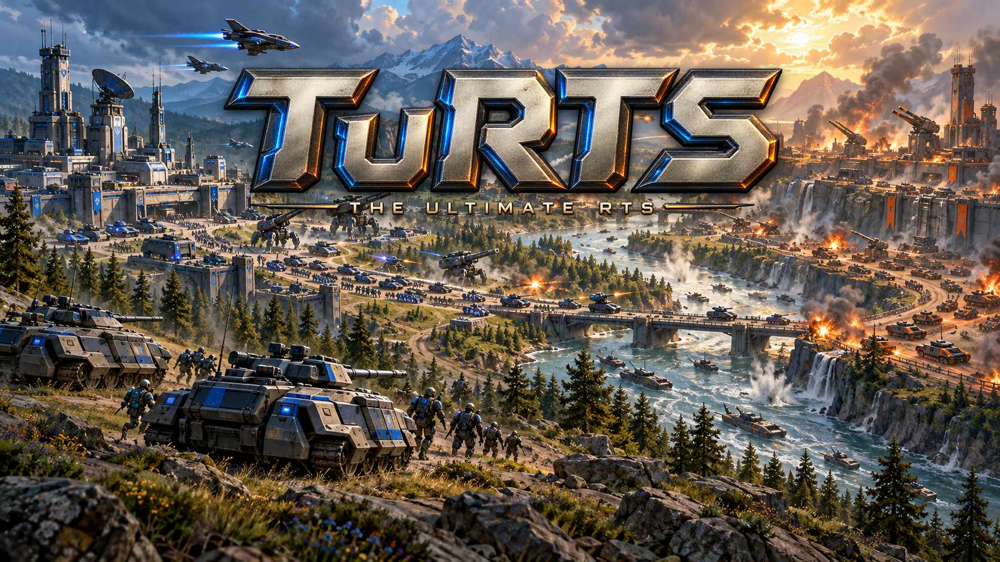

# TuRTS



[Concept art](docs/assets/turts-concept-art.png) · [Transparent title](docs/assets/turts-title.png)

[Social media kit](docs/assets/social/README.md) · [Download social images](docs/assets/social/turts-social-kit.zip)


TuRTS is a mod-first real-time strategy engine built with Rust and Bevy. It has a browser WebAssembly client, a native client, and an authoritative headless server. Game content is delivered as packages through the public mod API.

**Current playable demo: a medieval fantasy skirmish against the computer.** Build Barracks and Guard towers, harvest timber, train Villagers, Crossbowmen, Swordsmen, and Warriors, set rally points, fight, and reach Victory or Defeat. New skirmish starts another match. The browser build includes models, textures, team colours, graphics quality, pointer-centred zoom, walking and work animations, shot animation, construction rise, falling bodies, combat effects, attack warnings, a minimap, wider grass, a map boundary, distance haze, antialiasing, dirt clearings, and soft timber paths.

The local tested launcher is:

```sh
bash target/mc-evidence/play-skirmish.sh
```

[Rendering measurements](docs/measurements/models.md) record about 59 FPS for 400 fighting units on the local RTX 3080. The new three-type 2,000-unit stress battle reaches about 29 FPS High and 40 FPS Low. Hit sparks now appear above the armour. Selecting a unit shows its portrait, name, health, and own armour. A tooltip shows its weapon damage.

That launcher uses prepared local artifacts. To build from source, use `bash scripts/skirmish-play.sh --prepare /absolute/path/to/prepared`, then `bash scripts/skirmish-play.sh --prepared /absolute/path/to/prepared --silent`. Test browsers must use a fresh profile and `--alsa-output-device=null`.

Two local browsers can play one match through `bash target/mc-evidence/play-two-player.sh`.
Run its printed `JOIN_COMMAND` in another terminal.
For a temporary Internet game, use `bash target/mc-evidence/play-shared-skirmish.sh`.
This command needs `cloudflared`. It prints a trusted HTTPS address for both players.
Keep it running until the match ends. Anyone with the link can join.
A fresh join browser can start with `bash scripts/mp1-play.sh --join HTTPS_GAME_ADDRESS --silent`.
From a source-built prepared folder, use `python3 -I -B scripts/skirmish_share.py --prepared /absolute/path/to/prepared`.

Full local two-browser matches and public HTTPS/WSS orders pass scripted checks.
Fast reload keeps the same army and slot. Human games wait in a ready lobby with colour choices and a cancellable three-second countdown.
A full match played by two people and the full MP1 roster remain open.
The computer now trains a paid mixed army of Crossbowmen, Swordsmen, and Warriors, and builds a Guard tower. It now runs through the public mod bot framework. Shared remembered sightings now use the same engine authority as human players. Creator-authorized lobby selection remains open.
Authored map fog and bounded remembered sightings are now available to mods. Editable terrain now passes native and browser acceptance. Geological surveys, terrain occlusion, broader lifecycle features, and large-scale performance remain later work.

## Engine progress

The target is the full RTS engine in the [project specification](RTS-Engine-Project-Specifications.md).
The skirmish is its playable test bed. The table below tracks delivered capabilities.

Accepted milestones of spec section 14 (20 in all): `██████░░░░░░░░░░░░░░` 6 of 20.
- Accepted: M1, M2, M3, QA0, M4, MS.
- Partial (capabilities delivered; no recorded acceptance by a person): MC, MP1, MP2.
- Open: M4b and M5 (in progress on other branches), MB, M6, M7, M8, M9, M10, M11, M12, M13.

The count is of milestones, not of work. Milestones differ in size, so it gives no date.

| Capability | Verified progress | Evidence and remaining work |
| --- | --- | --- |
| Core simulation and mod content | Authoritative simulation, package loading, gathering, production, logistics, research, and combat are implemented. | Forge and Skirmish exercise these systems. Incremental payment, repair, cancellation, and safe destruction refunds pass native and browser acceptance. |
| Playable skirmish | Building, harvesting, paid mixed armies, rally points, Victory, Defeat, and restart pass browser checks. | [Normal-stat win and loss report](docs/reports/2026-11-14-full-skirmish.md). Full game content remains open. |
| Human multiplayer | Two browser clients, public HTTPS/WSS hosting, ready lobby, colour selection, and reload recovery pass scripted checks. | [Two-player report](docs/reports/2026-11-14-two-player-skirmish.md), [lobby report](docs/reports/2026-11-14-ready-lobby.md), [rejoin report](docs/reports/2026-11-14-fast-rejoin.md). A full match between two people remains unverified. |
| Presentation | Models, animations, effects, minimap, ground blending, and selected-unit portraits and health are delivered. | [Ground report](docs/reports/2026-11-14-ground-blending.md), [selection report](docs/reports/2026-11-14-unit-selection-panel.md). Custom shader support remains open. |
| Browser performance | All nine 400-unit High cases pass at 59.9-60.0 FPS, including fog and both zoom limits. The last 2,000-unit High check reached 28.81 FPS on an earlier build. | [Visibility measurements](docs/measurements/shared-visibility.md), [larger-model measurements](docs/measurements/models.md). No new 2,000-unit or hosting-capacity claim. |
| Damage system | Type tables, bonuses, optional armour curves, owner armour upgrades, automatic acquisition, Warriors, and Guard towers pass acceptance. | [Acceptance, independent review, and normal win](docs/reports/2026-11-14-damage-system.md). API 0.2.12; protocol 7. An independent test checks upgrade order and privacy in snapshots and deltas. The default game has no research lab yet. |
| Operating resources | Mod-defined slot supply, exact shortage rates, weapon Disable, and periodic income pass native and browser checks. | [Acceptance and limits](docs/reports/2026-11-15-operating-resources.md). API 0.2.13; protocol 7. The default Skirmish balance stays unchanged. Gathered accounting and its display remain open; a future counter test must exclude periodic income. |
| Paid work and repair | Exact incremental payment, construction cancellation, safe destruction refunds, and manual/automatic repair pass feature tests and the full browser fixture. | [Acceptance progress](docs/reports/2026-11-15-paid-work-and-repair.md). API 0.2.14; protocol 8. Acceptance and independent foundation review pass. Research ChargeOverTime and individual held-request cancellation remain open. |
| Public mod bots | Portable profiles, public Rust controllers, bounded observations, exact account coordination, shared command admission, and headless recorded/regenerated replay are implemented. | [SDK15 report](docs/reports/2026-11-15-public-bot-foundation.md). Final Skirmish and Stockyard browser probes pass. BF8 passed at 4.906851 ms p99 before later financial/profile fixes; those fixes were not remeasured. Full human/reference readiness remains open. |
| Shared visibility | Authored fog, team sharing, bounded stale sightings, hidden-target command rules, and atomic permitted human/bot state pass acceptance. | [SDK16 report](docs/reports/2026-11-15-shared-visibility.md). API 0.2.16; protocol 9. Independent code-running review, 2,924 native tests, full network acceptance, 60,000 measured server ticks, nine High camera cases, and scripted player probes pass. |
| Editable terrain | Plateau heights, excavation/fill, private seeded geology, persistent depletion, physical cargo, explicit unloading, permitted surface memory, raised picking, and traversable passages pass acceptance. | [M4 evidence and limits](docs/reports/2026-11-15-terrain-work-orders.md). API 0.2.17; protocol 10. Both public terrain packages, independent code-running review, 80,000 final measured ticks, three High400 views and scripted cold-play probes pass. Fully exposed million-cell maps exceed the decoded-state guard. |
| Scripting language (MS) | Rune 0.14.2 is selected from measured native and Chrome-wasm runs against budgets set before the runs. Rune adds 13.6 µs (native) and 60 µs (Chrome) script p99 for each tick at 1,000 units and 16 events, and 1,003,799 gzip bytes. | [MS report](docs/reports/2026-11-16-scripting-selection.md), [measurements](docs/measurements/scripting.md). Spike only: no production runtime and no engine change. The selection depends on one configuration decision (core Rune modules only; spec amendment 5). Rhai is selected instead if the CEO accepts its MPL-2.0 dependency. |
| Remaining engine scope | Shared group routing, geological discovery and terrain occlusion, the production script runtime, utilities, rooms, durable identity/saves, statistics, and spectator/replay delivery remain open. | M4b routing and M5a surveys are under implementation on separate branches. M5b obstruction has an approved spec and plan. The full project specification remains the target. |

Latest accepted build: `target/mc-evidence/skirmish-terrain-route-final-prepared` (API 0.2.17; protocol 10), sealed from source `2073e15e`.
All three local launchers use the frozen `TuRTS-terrain-play` checkout and this prepared build.
The actual normal launcher loads a populated world, models and minimap, with sound off and gzip WASM delivery.
Both final terrain browser scenarios and all three scripted cold-play product probes pass. The final M4 service run passes at 36.52–38.37 ms server p99. Its three 400-unit High views reach 59.5–59.8 FPS. The actual launcher starts a populated world with a fresh silent browser.
The checker reports PARTIAL-PASS with manual/reference checks open. The full fresh-agent and manual readiness procedure was not repeated.
The two-human and Internet modes retain their tested launch flags. Their full matches and a new normal-stat victory were not repeated for SDK16.
Default Skirmish uses its existing AllVisible map. Mods can opt into the new shared knowledge provider.
Tested milestones are merged and pushed to main under the CEO's standing approval.
Legacy browser fixtures now prove blocked output and real loss recovery with valid current exit rules.
CI keeps native, WebAssembly, process, browser, and test-tool checks. Historical fault campaigns remain manual. The SDK15 browser oracle now checks owner work and repair data against audit history. The [CI repair report](docs/reports/2026-11-15-ci-product-checks.md) records local validation and limits. The corrected hosted workflow has not run yet. Prior hosted browser runner losses remain unexplained.
See [working rules](AGENTS.md) for parallel delivery, review, and milestone integration.

The older Forge industrial demonstration remains available below. It proves extraction, conveyors, inserters, recipes, research, and ammunition combat through the public mod API. Its two-slot and restart restrictions describe that demonstration.

See the [project map](docs/reports/2026-11-13-project-overview.html), the [P2 spec](docs/superpowers/specs/2026-11-13-p2-animation.md), and the [model and animation measurements](docs/measurements/models.md). The project map includes the latest verified deliveries.

## Try Forge locally

The following starts a local server that serves the browser build and the package advertisement, lockfile, and archive. It copies the package to a temporary directory so the packer writes its archive outside the repository.

Requirements: Rust toolchain, `wasm32-unknown-unknown` target, Trunk 0.22, and a browser with WebGPU enabled. On Linux, the tested proof used headed Chrome under Xvfb with Vulkan/WebGPU flags; adapter availability depends on the host and browser.

From the repository root, in the first terminal:

```sh
ROOT="$(pwd)"
RUN_DIR="$(mktemp -d)"
DEMO_PACKAGE=forge
cp -a "$ROOT/mods/$DEMO_PACKAGE" "$RUN_DIR/$DEMO_PACKAGE"

# Build each Bevy binary in a separate Cargo command.
cargo build --release -p turts_server
cargo build --release -p turts_client
cargo run --release -p turts_pack --bin turts-pack -- "$RUN_DIR/$DEMO_PACKAGE"
(cd "$ROOT/crates/turts_client_web" && trunk build --release)

cat > "$RUN_DIR/server.ron" <<EOF
(
    game_package: "$RUN_DIR/$DEMO_PACKAGE.tar",
    http_listen: "127.0.0.1:7000",
    ws_listen: "127.0.0.1:7001",
    public_url: "http://127.0.0.1:7000",
    tick_hz: 20,
    static_dir: "$ROOT/crates/turts_client_web/dist",
)
EOF

"$ROOT/target/release/turts_server" "$RUN_DIR/server.ron"
```

Open this URL in the browser:

```text
http://127.0.0.1:7000/?server=http%3A%2F%2F127.0.0.1%3A7000&ws=ws%3A%2F%2F127.0.0.1%3A7001
```

To join with native clients instead, start one or two clients in separate terminals:

```sh
target/release/turts_client --server http://127.0.0.1:7000 --ws ws://127.0.0.1:7001 --player-id 1
target/release/turts_client --server http://127.0.0.1:7000 --ws ws://127.0.0.1:7001 --player-id 2
```

The server assigns the match slots during join and serves the package from its advertisement and lockfile. No separate lockfile editing is needed. The browser address and server fields above match the configuration schema in `turts_server --help`.

## The Forge demonstration

The first joined client owns a factory laid out by the package. Extraction, belts, inserters and the press run automatically. Select units to inspect stock, Main/Output inventory ports and status. Select the Proving Lab and use **Research Hardened Shells** when ten unreserved shells are available. After completion, the turret’s damage rises from 10 to 20.

The second joined client owns the two Target Drones. The nearby drone takes ten 10-damage hits. After the factory player confirms research completion, move the farther drone into turret range; it takes five 20-damage hits. Research is private to its owner. This is a factory/combat demonstration, with no victory condition or player construction.

Visible **Disable/Enable** controls pause eligible units. **Remove** is available only where the package permits it; removal destroys the unit’s contents. The prototype uses simple shapes and text panels, rather than finished game artwork.

Set `DEMO_PACKAGE=base` in the launch commands for the original gathering and unit-production demonstration. Start each test match with a fresh server; the two permanent slots are shared by browser tabs and native clients.

For a guided first session, see the [M3 playtest guide](vault/M3%20Playtest%20Guide.md).

## Build and check

```sh
cargo fmt --all --check
cargo clippy --workspace --all-targets --locked -- -D warnings
cargo check --workspace --exclude turts_server --target wasm32-unknown-unknown --locked
cargo test --workspace --locked
bash scripts/boundary.sh
bash scripts/acceptance.sh
bash scripts/m3-refutations.sh
bash scripts/m3-browser.sh
```

The browser proof uses headed Chrome under private Xvfb with Vulkan/WebGPU launch settings from CI. `bash scripts/m2-browser.sh` runs all 15 registered browser cases; list them with `bash scripts/m2-browser.sh --list-cases`.

Design and scope: [RTS Engine Project Specifications](RTS-Engine-Project-Specifications.md). Developer setup and crate commands: [CLAUDE.md](CLAUDE.md). Proof and measurements: [M3 measurement record](docs/measurements/m3.md) and [M2 measurement record](docs/measurements/m2.md).
