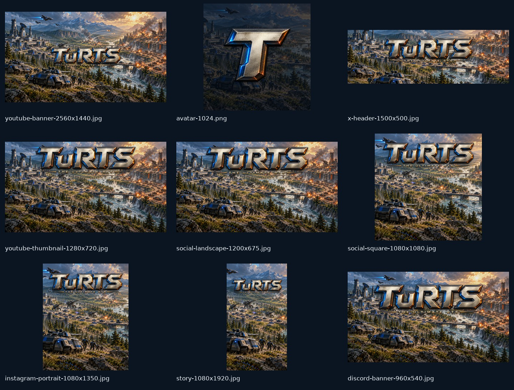

# TuRTS social media kit

Composed locally from the existing concept art and title. No images were regenerated.

[Download the upload kit](turts-social-kit.zip) · [View all layouts](social-kit-preview.jpg)

| File | Size | Use |
| --- | --- | --- |
| [youtube-banner-2560x1440.jpg](youtube-banner-2560x1440.jpg) | 2560 × 1440 | YouTube channel banner; branding centered for mobile crop |
| [youtube-safe-area-preview.jpg](youtube-safe-area-preview.jpg) | 2560 × 1440 | Reference only; do not upload |
| [avatar-1024.png](avatar-1024.png) | 1024 × 1024 | Shared profile image, original T isolated for circular crops |
| [youtube-avatar-800.png](youtube-avatar-800.png) | 800 × 800 | YouTube profile picture |
| [x-avatar-400.png](x-avatar-400.png) | 400 × 400 | X profile picture |
| [youtube-watermark-150.png](youtube-watermark-150.png) | 150 × 150 | Transparent video watermark |
| [x-header-1500x500.jpg](x-header-1500x500.jpg) | 1500 × 500 | X header |
| [youtube-thumbnail-1280x720.jpg](youtube-thumbnail-1280x720.jpg) | 1280 × 720 | Branded concept-art thumbnail |
| [social-landscape-1200x675.jpg](social-landscape-1200x675.jpg) | 1200 × 675 | Landscape teaser post |
| [social-square-1080x1080.jpg](social-square-1080x1080.jpg) | 1080 × 1080 | Square feed teaser |
| [instagram-portrait-1080x1350.jpg](instagram-portrait-1080x1350.jpg) | 1080 × 1350 | Portrait feed teaser |
| [story-1080x1920.jpg](story-1080x1920.jpg) | 1080 × 1920 | Vertical artwork for Stories, Reels and TikTok |
| [discord-banner-960x540.jpg](discord-banner-960x540.jpg) | 960 × 540 | Optional Discord server banner where available |

## Upload notes

- YouTube: upload the channel banner and YouTube avatar. The banner title sits inside a conservative central 1235 × 338 rectangle on the 2560 × 1440 canvas, within the mobile-safe area. The full image is visible on TV. The safe-area preview is a reference image only.
- Use `avatar-1024.png` for other accounts. The first T was extracted from the original logo to keep it readable when reduced or cropped to a circle.
- Square and portrait images are feed teasers. The vertical image is still artwork for Stories, Reels, and TikTok; it is not an animated video.
- The Discord server banner is optional and depends on the server having that feature.
- Artwork is concept art; label promotional posts accordingly. No launch date or account handle has been invented.

## Rebuild

Run `python3 scripts/create-social-assets.py` from the repository root. Requires Python 3, Pillow, and the DejaVu Sans font at `/usr/share/fonts/truetype/dejavu/DejaVuSans.ttf`. The source images remain in `docs/assets/`.

## Platform references

- [YouTube branding requirements](https://support.google.com/youtube/answer/10456525?hl=en): 2560 × 1440 recommended; 6 MB maximum; text safe area at minimum upload dimensions is 1235 × 338 on a 2048 × 1152 canvas.
- [X profile requirements](https://help.x.com/en/managing-your-account/how-to-customize-your-profile): 1500 × 500 header and 400 × 400 profile image.

Checked 2026-10-27.
